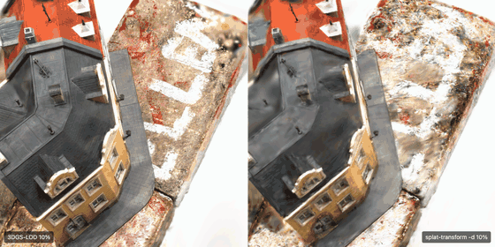

# 3DGS-LOD

[English](README.md) | 中文

**更好的网页 3D Gaussian Splatting 多级 LOD：用一半的高斯数达到相同画质。**
输出标准 **Streamed SOG**（`lod-meta.json`），原版 PlayCanvas 查看器无需修改即可加载。

`lodkit build` 输入训练好的 3DGS PLY 和训练它所用的 COLMAP 视角，输出更粗的 LOD 级别。在相同高斯数下，画质明显优于 PlayCanvas `splat-transform` 自带的抽稀。

<p align="center">
  
  <br>
  <sub>DTU scan6，两边都只保留 148 万高斯中的 10%，用浏览器（PlayCanvas）直接渲染最终交付的 Streamed SOG。
  左：3DGS-LOD；右：<code>splat-transform -d</code>。由 <a href="demo/make_gif.py"><code>demo/make_gif.py</code></a> 录制。</sub>
</p>

> 测试范围：2 个 DTU 物体（scan1、scan6），50% / 25% / 10% 三级预算，单张 RTX 4090。
> 浏览器帧率、首帧时间和手机实测**尚未完成**。

## 结果

所有数字都在 **Streamed SOG 编码 → 解码之后**的资产上测量，也就是浏览器实际加载的数据。
7 个留出视角（每 8 张取 1 张，构建时从不使用）。格式：mask 内 PSNR (dB) / SSIM / LPIPS / DTU overall（mm，相对 DTU 结构光参考扫描）。

| 物体 | 预算 | `splat-transform -d`（默认） | `-d` + 与我们相同的恢复 | **3DGS-LOD** |
|---|---|---|---|---|
| scan6 | 100%（teacher） | 26.47 / 0.884 / 0.085 / 1.95 | | |
| scan6 | 50% | 19.99 / 0.746 / 0.195 / 2.32 | 26.29 / 0.868 / 0.096 / 1.982 | **26.44 / 0.879 / 0.084 / 1.950** |
| scan6 | 25% | 18.68 / 0.700 / 0.248 / 2.49 | 25.94 / 0.854 / 0.118 / 2.017 | **26.34 / 0.873 / 0.090 / 1.982** |
| scan6 | 10% | 17.94 / 0.645 / 0.317 / 2.62 | **24.92** / 0.818 / 0.167 / **2.045** | 24.72 / **0.830 / 0.137** / 2.087 |
| scan1 | 100%（teacher） | 26.92 / 0.871 / 0.110 / 1.96 | | |
| scan1 | 50% | 20.25 / 0.742 / 0.235 / 2.35 | 26.38 / 0.845 / 0.151 / 1.974 | **26.58 / 0.859 / 0.117 / 1.949** |
| scan1 | 25% | 18.73 / 0.704 / 0.303 / 2.49 | 25.93 / 0.829 / 0.192 / 1.959 | **26.60 / 0.862 / 0.119 / 1.959** |
| scan1 | 10% | 18.08 / 0.667 / 0.383 / 2.60 | 25.19 / 0.783 / 0.251 / **2.015** | **25.27 / 0.816 / 0.167** / 2.028 |

结论：

- **对比默认流程：** 相同高斯数下，mask 内 PSNR 高 6.3 到 7.9 dB，LPIPS 低 50% 到 64%。我们的 10% 级比默认流程的 50% 级还高 4.7 到 5.0 dB。
- **对比加了相同恢复步骤的默认流程：** LPIPS 6/6 组更低（低 12% 到 38%），SSIM 6/6 组更高，PSNR 5/6 组更高（scan6 10% 低 0.20 dB）。在两个物体上，我们的 25% 级在每项指标上都持平或优于该基线的 50% 级，这就是「一半高斯数」的依据。
- **几何是打平，不是变好：** 相对参考扫描的误差差值都在 ±0.05 mm 以内。我们不宣称几何更好。

原始证据：[`evidence/`](evidence/)（每次运行的 `eval.json`、构建报告、[`summary.md`](evidence/summary.md)）。

## 默认抽稀为什么掉画质

在真实交付链路上的诊断（细节见 scripts 和 evidence）：

1. 用 `splat-transform -d` 删掉一半高斯，PSNR 掉约 6.5 dB，但 DTU 几何误差只从 1.95 升到 2.32 mm。
2. 损失**不**来自 SOG 编码：抽稀后的 PLY 与其 SOG 解码版本相差不到 0.1 dB。
3. 损失在**颜色和不透明度**：合并后的粗级不透明度大幅降低（平均 logit 从 1.01 降到 −0.36）。

所以改进针对的是外观，而不是几何。

## 方法

```text
teacher PLY + 训练视角（相机 + 图像）
  1. 贡献分数：训练视角上的 Σ T·α（一次反传得到，精确包含遮挡）
  2. 每一级：按贡献保留 top-k
  3. 几何门控合并：每个被删高斯只并入最近的保留高斯，且要求
     法向一致（|cos| > 0.8）、距离足够近（< 3 倍尺度）；贡献加权矩匹配
  4. 固定几何恢复：冻结位置/尺度/旋转，只优化 SH 和不透明度
     （3000 步，L1 + 0.2 D-SSIM，只用训练视角）
  5. 用官方 splat-transform 3.10.0 打包 → 标准 Streamed SOG
```

恢复阶段不会凭空造出几何（位置被冻结）；留出视角从不参与。

## 用法

依赖：CUDA GPU、Python ≥ 3.10、Node.js ≥ 22（用于 `npx @playcanvas/splat-transform@3.10.0`）。

```bash
pip install -e '.[gpu]'          # torch + gsplat 1.5.3
lodkit build --data path/to/colmap --teacher point_cloud.ply --out out/
# -> out/lod1..3.ply, out/streamed/lod-meta.json, out/build_report.json
lodkit decode out/streamed/lod-meta.json --level 2 --out lod2.ply
```

- `--data` 必须是训练 teacher 时用的 COLMAP 目录（`images/`、`sparse/0/`），并使用 gsplat 默认的世界坐标归一化。`lodkit` 精确复现了 gsplat `Parser` 的坐标系（已验证：位姿差 < 5e-8，内参和数据划分完全相同；见 [`evidence/*/scene_equivalence`](evidence/)）。
- 只支持去畸变后的针孔相机。
- 参数：`--levels 0.5,0.25,0.1`、`--recover-steps 3000`（0 表示关闭）、`--no-merge`、`--test-every 8`。

耗时：148 万个高斯、三级，在 RTX 4090 上 **173 秒**（打分 9 秒，三级分别 42/24/13 秒，打包 85 秒）。用打包后的 CLI 重跑，结果与 evidence 相差 0.02 dB 以内（[`evidence/scan6/lodkit_repro`](evidence/scan6/lodkit_repro)）。

## 评测协议

- 数据：DTU SampleSet scan1/scan6，light 3，800×600。官方 DTU 投影矩阵保持固定，COLMAP 只用于三角化初始点（重投影误差约 0.5 px）。坐标系检查：三角化点到 STL 的中位距离 0.37 mm，随机点为 81 mm。
- teacher：gsplat v1.5.3 上游 `simple_trainer.py default`，30k 步。
- 几何：渲染深度反投影到 DTU 毫米坐标，在 ObsMask 内计算 accuracy/completeness（20 mm 截断），取平均作为「DTU overall」。参考是结构光扫描，不是 CAD 真值。
- 公平性：基线使用完全相同的恢复步骤，并且和我们一样只经过一次 SOG 量化。

## 局限

- 需要训练视角和相机；`splat-transform` 只需要 PLY。没有视角时，请用 `splat-transform -d`。
- 只测了 2 个 DTU 物体（转台物体，145 万到 148 万个高斯）；还没有 Mip-NeRF 360 场景。
- 还没有浏览器帧率、首帧时间和显存测量；高斯数相同意味着渲染开销相近，但这一点尚未实测。
- 没有与 LightGaussian、AtlasLC、CVT-GS 对比。
- 恢复步数（3000）没有调参。

## 仓库结构

- `lodkit/`：可安装的包（`build`、`decode`、PLY/COLMAP 读写、合并、恢复）
- `scripts/`：生成 `evidence/` 的实验脚本（基线、消融、评测）
- `evidence/`：全部结果 JSON
- `tests/`：CPU 单元测试（`pytest`）

## 致谢

基于 [PlayCanvas splat-transform](https://github.com/playcanvas/splat-transform)（MIT）、[gsplat](https://github.com/nerfstudio-project/gsplat)（Apache-2.0，借鉴了其世界坐标归一化）和 [DTU MVS 数据集](https://roboimagedata.compute.dtu.dk/?page_id=36)。

## 许可证

MIT
